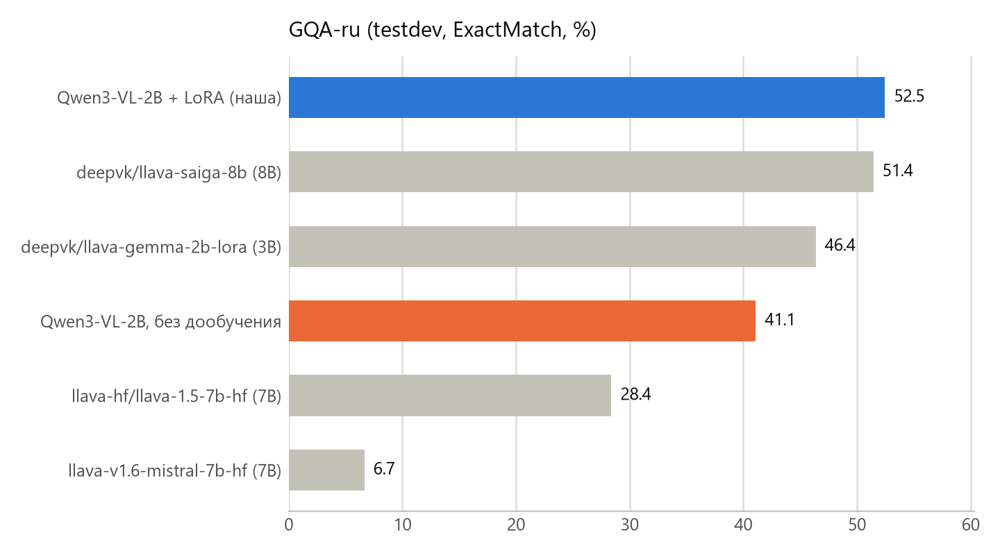
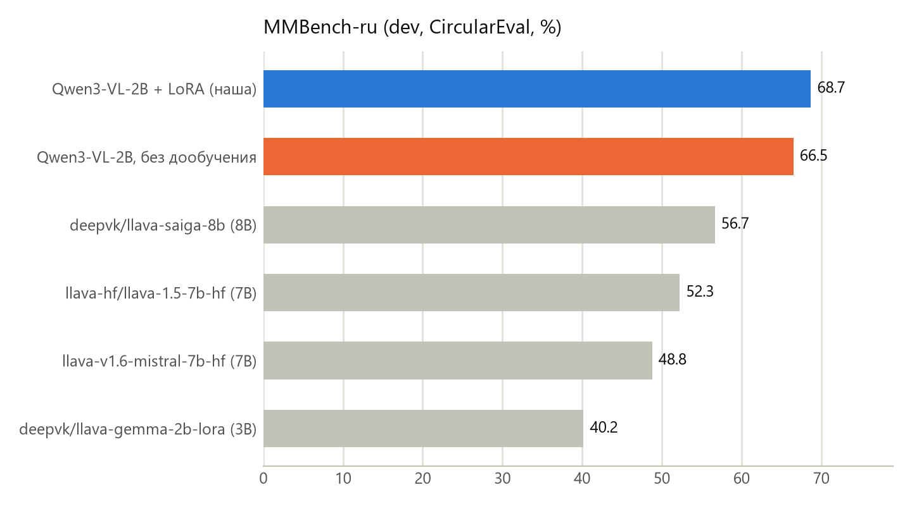
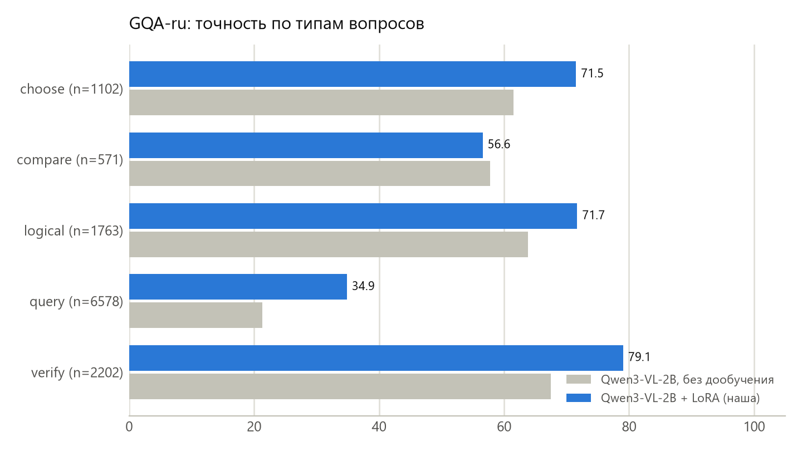
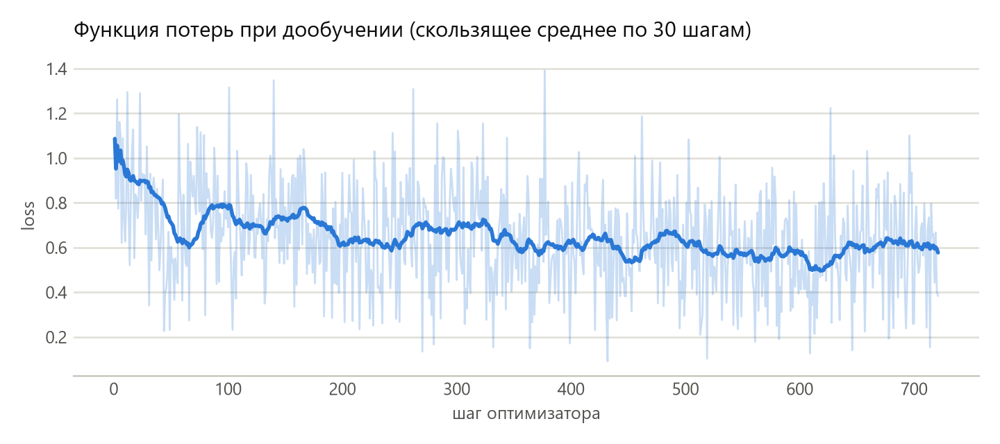

# Компактная русскоязычная VLM на открытых данных VK

**Qwen3-VL-2B-Instruct + LoRA, дообученная на датасетах [deepvk](https://huggingface.co/collections/deepvk/vision-language-modeling-664dd7e4c257cc78e740f6bc) на одной ноутбучной GPU 8 ГБ.**

| Модель | Параметры | Обучение | GQA-ru (EM) | MMBench-ru (Circular) |
|---|---|---|---|---|
| deepvk/llava-gemma-2b-lora | 3B | 1×A100, 3 дня | 46.4 | 40.2 |
| deepvk/llava-saiga-8b | 8B | 8×A100, 3–4 дня | 51.4 | 56.7 |
| Qwen3-VL-2B-Instruct (без дообучения) | 2B | — | 41.1 | 66.5 |
| **Qwen3-VL-2B + LoRA (наша)** | 2B | **RTX 5060 Laptop 8 ГБ, 38 мин** | **52.5** | **68.7** |

Метрики моделей VK — из их карточек (lmms-eval, MMBench без GPT-судьи). Наши — собственными скриптами по тому же
протоколу (см. раздел 4). Демо: `python src/demo.py`.

## 1. Описание проекта

### Зачем
Визуально-языковые модели (VLM) отвечают на вопросы по изображениям в свободной форме. Сильные открытые VLM
либо большие (7B+ параметров, нужны серверные GPU), либо плохо работают на русском. Открытые русскоязычные
модели VK (`deepvk/llava-gemma-2b-lora`, `deepvk/llava-saiga-8b`) обучались на 1–8 GPU A100 в течение нескольких дней.

Проект проверяет гипотезу: **современная компактная VLM (2B), дообученная на открытых данных VK методом LoRA
меньше чем за час на потребительской видеокарте, может превзойти по русскоязычным бенчмаркам открытые модели VK,
в том числе 8B-модель.** Такая модель работает локально (изображения не покидают устройство) и дёшево
в эксплуатации, что важно для сценариев вроде описания фото для незрячих пользователей, предразметки и
модерации пользовательского контента, поиска по фото товаров.

### Цель
Получить модель ≤ 3B параметров, которая на бенчмарках VK **GQA-ru** и **MMBench-ru** показывает метрику выше,
чем открытые модели VK, используя для обучения только открытые данные VK и одну GPU 8 ГБ.

### Задачи
1. Изучить датасеты коллекции deepvk и протокол оценки (`lmms-eval`), воспроизвести его в собственном скрипте.
2. Выбрать базовую модель; измерить её качество без дообучения (zero-shot).
3. Собрать обучающую смесь из данных VK (GQA-ru train, LLaVA-Instruct-ru) с аугментацией под формат MMBench.
4. Дообучить LoRA-адаптер в рамках 8 ГБ видеопамяти.
5. Оценить на GQA-ru (testdev) и MMBench-ru (dev), сравнить с бейзлайнами, разобрать ошибки.
6. Сделать демо, подробный отчёт и презентацию.

### Ожидаемые результаты
* GQA-ru ExactMatch выше 51.4 (лучший результат моделей VK, `llava-saiga-8b`);
* MMBench-ru не хуже исходной модели (дообучение не должно ломать общие навыки);
* LoRA-адаптер размером в десятки МБ + воспроизводимый код обучения и оценки + демо.

## 2. Результаты

* **GQA-ru (testdev, 12 216 вопросов):** 41.1 → **52.5** ExactMatch (+11.4 п.п.). Это выше обеих моделей VK, в том числе
  llava-saiga-8b, которая в 4 раза больше (+1.0 п.п.). На hold-out из картинок train: 43.0 → 60.0.
* **MMBench-ru (dev, CircularEval):** 66.5 → **68.7**. Оговорка: у исходной модели 6% ответов — рассуждение вместо буквы
  (обрезано лимитом в 32 токена); если засчитать их все как верные, её верхняя граница — 72.1. Корректный вывод —
  общие навыки после дообучения не пострадали, а прирост в основном за счёт формата ответа; обе версии Qwen3-VL-2B
  заметно опережают модели VK (56.7).
* **Что дало дообучение на GQA-ru:**
  1. Калибровка «да/нет»: исходная модель отвечала «нет» в 67% случаев (в эталоне 48.5%). Точность на «да/нет»
     выросла с 65.3 до 73.9.
  2. Форма ответов датасета: «слева», а не «левая», без английских ответов («elephant»). Точность на открытых
     вопросах выросла с 27.4 до 40.3.
* **Инференс:** 4.7 ГБ видеопамяти (батч 16), короткий ответ — 0.21 с, описание на 128 токенов — 3.2 с, 13.8 вопроса/с
  в батче. Развёрнутые ответы модель не разучилась давать (см. `results/inference.json`).

|  |  |
|---|---|
|  |  |

Подробности, разбор ошибок и примеры — в [отчёте](docs/report.pdf) и [results/analysis.md](results/analysis.md).

## 3. Данные VK и как они использовались

| Датасет | Роль | Что взято |
|---|---|---|
| [deepvk/GQA-ru](https://huggingface.co/datasets/deepvk/GQA-ru) `train_balanced` | обучение + hold-out | 6 000 картинок → 8 730 вопросов; ещё 300 картинок (437 вопросов) отложены для контроля |
| [deepvk/GQA-ru](https://huggingface.co/datasets/deepvk/GQA-ru) `testdev_balanced` | бенчмарк | 12 216 вопросов, только для итоговой оценки |
| [deepvk/MMBench-ru](https://huggingface.co/datasets/deepvk/MMBench-ru) `dev` | бенчмарк | 3 910 записей (1 109 вопросов × циклические перестановки), только для оценки |
| [deepvk/LLaVA-Instruct-ru](https://huggingface.co/datasets/deepvk/LLaVA-Instruct-ru) | регуляризация | 800 коротких диалогов (картинки COCO) |

Обучающая смесь ([`src/prepare_data.py`](src/prepare_data.py), [`data/processed/stats.json`](data/processed/stats.json)):
* **gqa (8 730)** — «вопрос + `\nОтветь одним словом.`» → короткий ответ (формат бенчмарка и обучения моделей VK);
* **gqa_mc (2 000)** — открытые вопросы GQA-ru, превращённые в вопросы с 4 вариантами в формате MMBench → буква.
  Дистракторы — частые ответы на вопросы того же детального типа; бинарные типы и словоформы ответа исключены.
  Под MMBench-ru нет обучающих данных, поэтому эта аугментация учит формату множественного выбора, не трогая бенчмарк;
* **llava (800)** — развёрнутые ответы, чтобы модель не разучилась отвечать подробно.

## 4. Метод

* База: [Qwen/Qwen3-VL-2B-Instruct](https://huggingface.co/Qwen/Qwen3-VL-2B-Instruct) (bf16, SDPA), картинки до 448×448 px (≤196 визуальных токенов).
* LoRA r=16, α=32, dropout 0.05 на всех линейных слоях языковой модели (17.4 млн обучаемых параметров, 0.81%);
  визуальный энкодер и проектор заморожены.
* 1 эпоха, батч 4 × накопление 4, AdamW lr 2e-4, косинусное расписание, gradient checkpointing.
* Лосс только по ответам ассистента; логиты считаются **только на позициях ответа** (`logits_to_keep`) —
  без этого обучение падало с OOM на 8 ГБ, с ним пик памяти 7.3 ГБ и скорость ×2.
* Оценка повторяет lmms-eval: GQA-ru — ExactMatch (без учёта регистра и пунктуации);
  MMBench-ru — CircularEval (вопрос засчитан, только если верно отвечены все перестановки вариантов), буква
  извлекается правилами, без GPT-судьи.

## 5. Структура репозитория

```
src/
  common.py         пути, промпты (как в lmms-eval), нормализация ответов, загрузка модели
  download.py       многопоточная загрузка с HF Hub (HTTP Range, ~8 МБ/с вместо 0.4)
  prepare_data.py   сборка обучающей смеси из GQA-ru и LLaVA-Instruct-ru (+ MC-аугментация)
  train_lora.py     цикл обучения LoRA
  eval_gqa.py       оценка на GQA-ru (testdev или hold-out)
  eval_mmbench.py   оценка на MMBench-ru (CircularEval)
  make_figures.py   графики и сводная таблица
  analyze.py        анализ ошибок
  demo.py           Gradio-демо
run_pipeline.sh     обучение -> все оценки -> графики
outputs/lora-adapter/  обученный адаптер
results/            метрики (*.json), предсказания (*.jsonl), лог обучения, графики
docs/               отчёт (PDF/DOCX), презентация (PPTX) и их генераторы
```

## 6. Воспроизведение

Проверено на Windows 11, Python 3.14, RTX 5060 Laptop 8 GB.

```bash
python -m venv .venv && .venv/Scripts/activate
pip install torch==2.11.0 torchvision==0.26.0 --index-url https://download.pytorch.org/whl/cu128
pip install -r requirements.txt

python src/download.py model gqa-train llava          # ~8 ГБ
python src/prepare_data.py --n-images 6000 --n-mc 2000 --n-llava 800
bash run_pipeline.sh --epochs 1 --batch-size 4 --grad-accum 4 --lr 2e-4 --r 16

python src/demo.py                                    # http://127.0.0.1:7860
```

Использование адаптера в своём коде:

```python
import torch
from transformers import AutoProcessor, Qwen3VLForConditionalGeneration
from peft import PeftModel

base = "Qwen/Qwen3-VL-2B-Instruct"
model = Qwen3VLForConditionalGeneration.from_pretrained(base, dtype=torch.bfloat16, device_map="cuda")
model = PeftModel.from_pretrained(model, "outputs/lora-adapter").merge_and_unload()
processor = AutoProcessor.from_pretrained(base, max_pixels=448 * 448)

messages = [{"role": "user", "content": [{"type": "image", "image": "photo.jpg"},
                                         {"type": "text", "text": "Что лежит на столе?\nОтветь одним словом."}]}]
inputs = processor.apply_chat_template(messages, add_generation_prompt=True, tokenize=True,
                                       return_dict=True, return_tensors="pt").to("cuda")
out = model.generate(**inputs, max_new_tokens=16, do_sample=False)
print(processor.decode(out[0, inputs["input_ids"].shape[1]:], skip_special_tokens=True))
```

## 7. Ограничения

* Метрики моделей VK взяты из их карточек (lmms-eval); наши — собственная реализация того же протокола.
* Прирост на GQA-ru в основном — калибровка «да/нет» (исходная модель склоняется к «нет») и усвоение формы
  ответов датасета («слева», а не «левая»; предлоги; род). Рост визуального «понимания» отдельно не измерялся.
* MMBench-ru не имеет обучающей части; MC-аугментация из GQA не покрывает OCR, диаграммы, научные вопросы.
* Один прогон без подбора гиперпараметров — из-за сроков проекта.

## Материалы
* [docs/report.pdf](docs/report.pdf) / [docs/report.docx](docs/report.docx) — подробное описание решения;
* [docs/presentation.pptx](docs/presentation.pptx) — презентация;
* [outputs/lora-adapter/](outputs/lora-adapter/) — обученный LoRA-адаптер;
* [results/](results/) — метрики, предсказания, графики.
